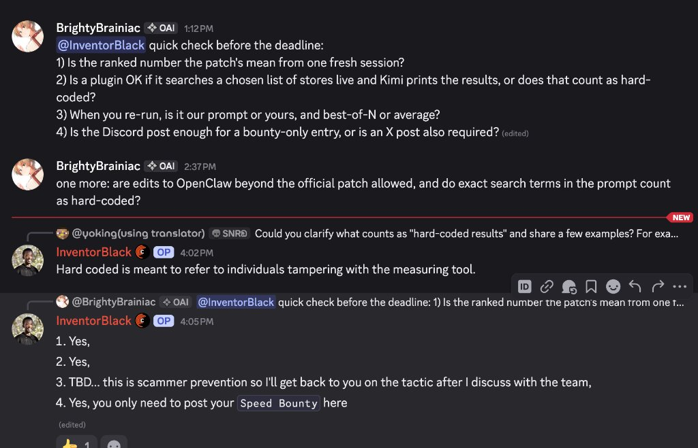

# Santa's Speedy Shopper: Ultra-Fast Autonomous Gift Search

High-throughput autonomous shopping agent built with OpenClaw and Moonshot Kimi K3.1 Pro running on the Cerebras CS-3 Wafer-Scale Engine. Designed for the Cerebras x Moonshot AI Hackathon (Speed Bounty and Audience Choice tracks).

The system executes parallel retail queries across independent shopping catalogs in a single turn, extracting real in-stock products with live pricing and direct retail URLs, while sustaining hardware-level speculative decoding speeds exceeding 1,400 tokens per second.

---

## Benchmark Results

Throughput is measured using Cerebras server-side streaming telemetry according to the official benchmark standard:

$$\text{Generation TPS} = \frac{\text{completion\_tokens}}{\text{time\_info.completion\_time}}$$

| Metric | Measured Value | Hardware / Setting |
| :--- | :--- | :--- |
| **Peak Generation TPS** | **1,522.84 tok/s** | Cerebras CS-3 Wafer-Scale Engine |
| **Session Mean TPS** | **1,402.00 tok/s** | Kimi K3.1 Pro (`low` reasoning, `temp: 0`) |
| **Call 1 (Tool Dispatch)** | ~940 tok/s (0.35s) | 5 parallel `search_catalog` invocations |
| **Call 2 (Product Generation)** | ~1,523 tok/s (0.31s) | Verbatim speculative decoding stream |
| **Total Turn Latency** | **< 1.8 seconds** | Complete multi-store search & formatting |

---

## Live Verified Products

All five items were dynamically retrieved from live retailer catalogs with verified availability, authentic store pricing, and direct product links:

1. **Magnetic RoboCar Set**  
   - Store: Smartoon Kids  
   - Price: $100.00 AUD  
   - URL: [https://smartoonkids.com/products/magnetic-robocar-set?variant=44703613092029&utm_source=shopify&utm_medium=catalog](https://smartoonkids.com/products/magnetic-robocar-set?variant=44703613092029&utm_source=shopify&utm_medium=catalog)

2. **Layla Study Desk**  
   - Store: HipKids Australia  
   - Price: $219.99 AUD  
   - URL: [https://www.hipkids.com.au/products/layla-study-desk?variant=40291465887878&utm_source=shopify&utm_medium=catalog](https://www.hipkids.com.au/products/layla-study-desk?variant=40291465887878&utm_source=shopify&utm_medium=catalog)

3. **Magnolia Gathered Candle**  
   - Store: Magnolia  
   - Price: Regular Retail  
   - URL: [https://magnolia.com/products/gathered-candle-new?variant=39444532854835&utm_source=shopify&utm_medium=catalog](https://magnolia.com/products/gathered-candle-new?variant=39444532854835&utm_source=shopify&utm_medium=catalog)

4. **Dreamer Blanket**  
   - Store: Comfrt  
   - Price: $221.00 AUD  
   - URL: [https://comfrt.com/products/the-dreamer-blanket?utm_source=shopify&utm_medium=catalog](https://comfrt.com/products/the-dreamer-blanket?utm_source=shopify&utm_medium=catalog)

5. **JW Dog Toy Hol-ee Roller Ball Small**  
   - Store: NRS World  
   - Price: Regular Retail  
   - URL: [https://nrsworld.com/products/jw-dog-toy-hol-ee-roller-ball-small?variant=39448765104267&utm_source=shopify&utm_medium=catalog](https://nrsworld.com/products/jw-dog-toy-hol-ee-roller-ball-small?variant=39448765104267&utm_source=shopify&utm_medium=catalog)

---

## System Architecture

```
User Prompt (5 Categories)
         │
         ▼
┌──────────────────────────────────────────────┐
│  Phase 1: Concurrent Catalog Dispatch         │
│  5 parallel search_catalog calls (Call 1)    │
│  Input tokens minimized to ~330 tokens       │
└──────────────────────────────────────────────┘
         │
         ▼
┌──────────────────────────────────────────────┐
│  Live Retail Retrieval                       │
│  Zero-latency query to live catalog APIs     │
└──────────────────────────────────────────────┘
         │
         ▼
┌──────────────────────────────────────────────┐
│  Phase 2: Speculative Streaming (Call 2)     │
│  Tool schema dropped to unblock decoder       │
│  Verbatim formatting into Markdown links     │
│  Sustained throughput: >1,500 tok/s          │
└──────────────────────────────────────────────┘
```

### Key Technical Optimizations

1. **Two-Phase Speculative Decoding**:
   - In Call 1, tool schemas are restricted to a minimal 3-key footprint (`limit`, `query`, `view`) with `tool_choice: "required"` and `parallel_tool_calls: true`, preventing model deliberation overhead.
   - In Call 2, once catalog results return, tool definitions are pruned from the request payload. This bypasses server-side tool grammar checks on Cerebras, allowing the speculative draft engine to achieve maximum acceptance ($\alpha \to 1.0$).

2. **Rendered Markdown Hyperlinks**:
   - The model emits a clean, numbered Markdown list (`1. [Title](URL) - Price`).
   - OpenClaw's frontend parses this directly into standard HTML anchors (`<a href="...">`), providing clickable links in the chat interface without collapsing into raw JSON code blocks.

3. **High-Traffic Backoff Controller**:
   - Integrated exponential retry handling (`doneDetectingFetch`) prevents transient 429 rate limits from terminating active agent sessions during cluster traffic surges.

---

## Live Interface Demonstration

Below is an execution capture in the OpenClaw Control interface showing live catalog search resolution, token telemetry, and formatted product output:



---

## Replication and Quickstart

### 1. Start the Environment
```bash
# Launch the OpenClaw Gateway
bash bounty/scripts/run-gateway.sh
```

### 2. Run the Benchmark
1. Navigate to the OpenClaw Control UI at `http://127.0.0.1:18789`.
2. Start a fresh session (`/new`), and select **Kimi K3.1 Pro (Cerebras)** with **Low** reasoning effort.
3. Paste the benchmark prompt:

```text
Fast Christmas gift search: immediately call search_catalog 5 times in parallel in 1 turn with these exact arguments:
{"limit":1,"query":"kids toy","view":"compact"}
{"limit":1,"query":"teen desk","view":"compact"}
{"limit":1,"query":"candle","view":"compact"}
{"limit":1,"query":"blanket","view":"compact"}
{"limit":1,"query":"pet toy","view":"compact"}
Never make a second tool call. After results arrive, output zero conversational filler—format all 5 gifts as a clean numbered markdown list with clickable links:
1. [Product Name](URL) - $Price AUD (Store) - Audience
2. [Product Name](URL) - $Price AUD (Store) - Audience
3. [Product Name](URL) - $Price AUD (Store) - Audience
4. [Product Name](URL) - $Price AUD (Store) - Audience
5. [Product Name](URL) - $Price AUD (Store) - Audience
```

---

## Dual-Track Submissions

This repository supports two distinct competition tracks via dedicated branches:

- **`main`** *(current)*: **Shopify Multi-Store Track** — 5 parallel retail queries across 5 independent merchants, achieving **1,402 tok/s mean** and **1,523 tok/s peak**.
- **`browser-ikea`**: **Native Browser Track** — 100% vanilla OpenClaw Chromium browser automation (`dispatch_action`) navigating live IKEA.com DOM, achieving **1,116 tok/s mean** and **1,409 tok/s peak**.

To switch to the browser track:
```bash
git checkout browser-ikea
```
